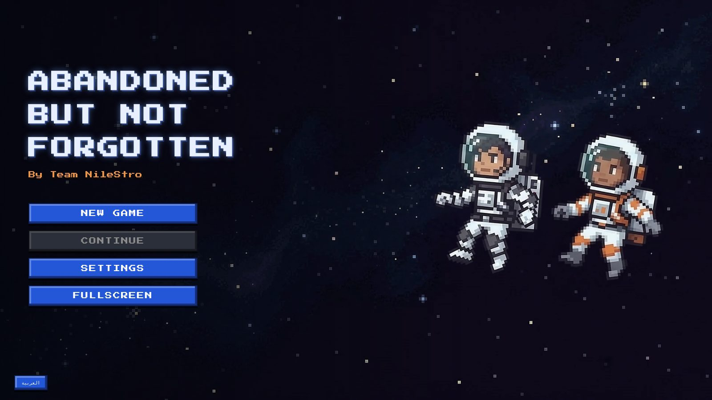
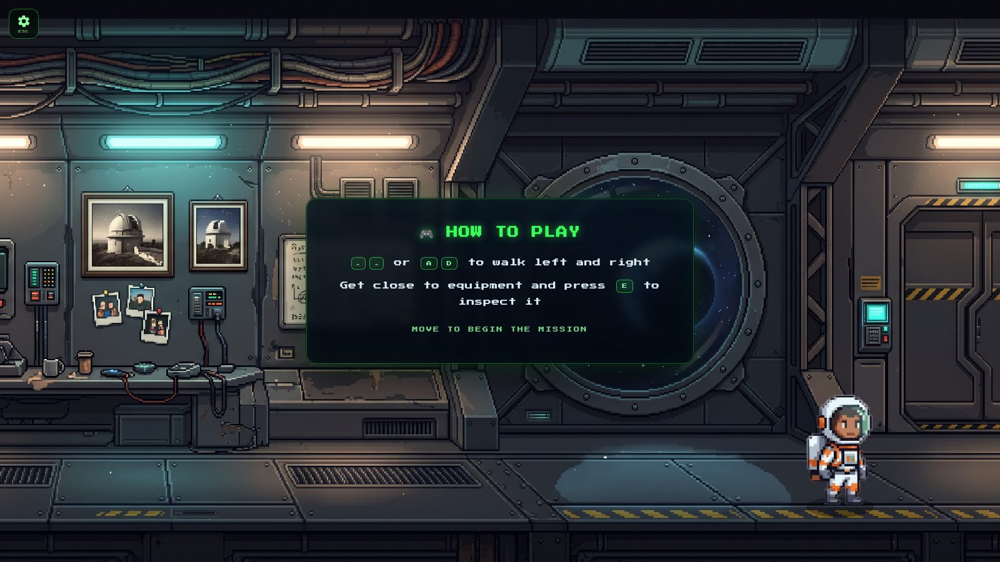

# OSIRIS — Abandoned But Not Forgotten

> A bilingual (English / العربية) space-story game about the machines NASA left behind on the Moon and Mars.
>
> Built from scratch by **Team NileStro** (Egypt) for the [NASA Space Apps Challenge 2026](https://www.spaceappschallenge.org/2026/challenges/nasas-discarded-equipment-storytelling) — challenge **“Abandoned but not Forgotten: Storytelling about NASA’s Discarded Equipment on the Moon and Mars.”**

---

## Screenshots

| Main menu (English default) | Gameplay — the damaged cockpit |
| --- | --- |
|  |  |

---

## About the Game

Since the 1960s, NASA has left hardware across the solar system — rovers, landers, probes and instruments that finished their science missions and were left standing silently as monuments to exploration. **OSIRIS: Abandoned But Not Forgotten** turns that hidden heritage into an interactive, story-driven adventure for school-age space enthusiasts.

The story follows two siblings, **Tariq** and **Zain**, on a journey across two chapters:

- **Chapter 1 — The Moon:** Zain repairs a damaged spacecraft, lands at a real Apollo site, and walks through the actual leftovers of the Apollo program — bootprints, the flag, the Lunar Roving Vehicle, the *Eagle* ascent stage, the LRRR laser reflector and the PSEP experiment — learning what each machine did for science.
- **Chapter 2 — Mars, the Space Heritage Garden:** the journey continues to Mars to visit three real robotic explorers: **Sojourner**, **InSight** and **Opportunity** — and ends with a heartfelt reunion on the Martian plain.
- **Post-credits epilogue:** after the ending, the player steps “behind the scenes” into NileStro HQ and walks through the four offices of the development team, meeting every member and hearing how the game was made.

Everything the player meets is a real machine with a real mission history — the narrative shows *how the hardware operated and what science it made possible*, rather than listing facts.

### Why it fits the challenge

| Challenge ask | How OSIRIS answers it |
| --- | --- |
| Story-driven educational tool for school-age enthusiasts | A playable two-chapter narrative with characters, dialogue and emotion — not a fact sheet |
| Weave real historical facts and mission data into the story | Every station (Apollo hardware, LRV, LRRR, PSEP, Sojourner, InSight, Opportunity) is historically accurate and scientifically verified |
| Show how missions operated rather than listing facts | The player repairs, lands, drives and walks through the hardware step by step |
| Accuracy throughout | All mission facts were researched and verified from NASA sources by the team’s science researchers |
| Reach as many learners as possible | Full English **and** Arabic (with proper RTL support) — plus a downloadable children’s story and a teacher guide (PDF) inside the game |

---

## Features

- **Bilingual by design** — English (default) and Arabic, switchable any time from the menu or settings; Arabic gets full right-to-left layout.
- **Cinematic main menu** — live animated background with full asset preloading (images + videos) and a real progress bar: no black screens or missing assets during play.
- **Two full chapters** — 25+ walkable rooms on the Moon and Mars with pixel-art characters and interactive points.
- **Dialogue system** — bilingual conversations with history and science woven into the plot.
- **Interactive team epilogue** — meet the four team members behind the game, in-game.
- **Companion PDFs** — a children’s story and a teacher guide, downloadable from the settings panel.
- **Fullscreen mode** — from the main menu and from the settings panel.
- **Local saves** — progress is stored in the browser (localStorage) and can be continued any time.
- **Zero dependencies** — pure HTML5 + CSS + vanilla JavaScript. No build step, no framework, no server, no database.

---

## Play It

The game is a fully static site. Any static host works — pick one:

### GitHub Pages

1. Enable **Settings → Pages → Deploy from a branch → `main` / `(root)`** on this repository.
2. Open `https://<your-username>.github.io/OSIRIS/`.

### Vercel

1. **Add New… → Project** and import this repository.
2. Framework preset: **Other** (it is a plain static site — no build command, output directory is the repository root).
3. Deploy.

### itch.io

1. Zip the repository contents with `index.html` at the root of the zip.
2. Upload as an **HTML game** and tick “This file will be played in the browser”.

### Locally

Just open `index.html` in a browser, or serve the folder with any static server (`python3 -m http.server`).

> **Tip:** the game preloads ~85 MB of media before playing — on first load give it a few seconds on the progress bar.

---

## Controls

| Key | Action |
| --- | --- |
| Arrows / A · D | Move |
| E | Interact with points, doors and characters |
| X or click | Advance / skip dialogue |
| ESC / Tab | Settings during play |

---

## Repository Structure

```
index.html        Entry point: main menu + scene 1 + scene 2 (single page)
scene1.html       History-log screen (optional standalone page)
scene2.html       Gameplay (optional standalone page)
css/              Menu & scene styles
js/assets.js      Media manifest — the single source of every asset path
js/preload.js     Full asset preloading with byte-level progress
js/i18n.js        English/Arabic dictionary
js/main.js        Menu logic, language, fullscreen, saves, scene sequencing
js/scene1.js      CRT history-log scene
js/scene2.js      Full gameplay engine (ship → Moon → Mars → epilogue)
assets/           Images, videos and the companion PDFs
```

---

## Team NileStro

| Member | Role |
| --- | --- |
| **Malak Kotp** | Team leader — biotechnology researcher, scientific data analysis, children’s comic book |
| **Ranya Ibrahem** | Scientific content researcher — verified every mission fact from NASA sources, narrative dialogue, educational PDF |
| **Mohamed Ashraf** | Web developer — built the entire game engine in HTML5/JS/CSS, pixel-art assets, sound design, deployment |
| **Mazen Ashraf** | Navigation science & space technology engineer — orbital trajectory design, systems thinking, narrative structure |

---

## Credits & Rights

- Historical images used in the story scenes are from NASA archives and are in the **public domain**.
- Fonts: [Press Start 2P](https://fonts.google.com/specimen/Press+Start+2P) and [Handjet](https://fonts.google.com/specimen/Handjet) — SIL Open Font License.
- Game code, story and original art © **Team NileStro**.

> *Abandoned in space… but never forgotten.*
